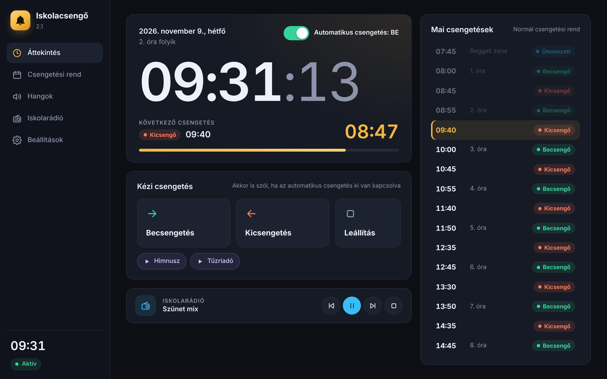
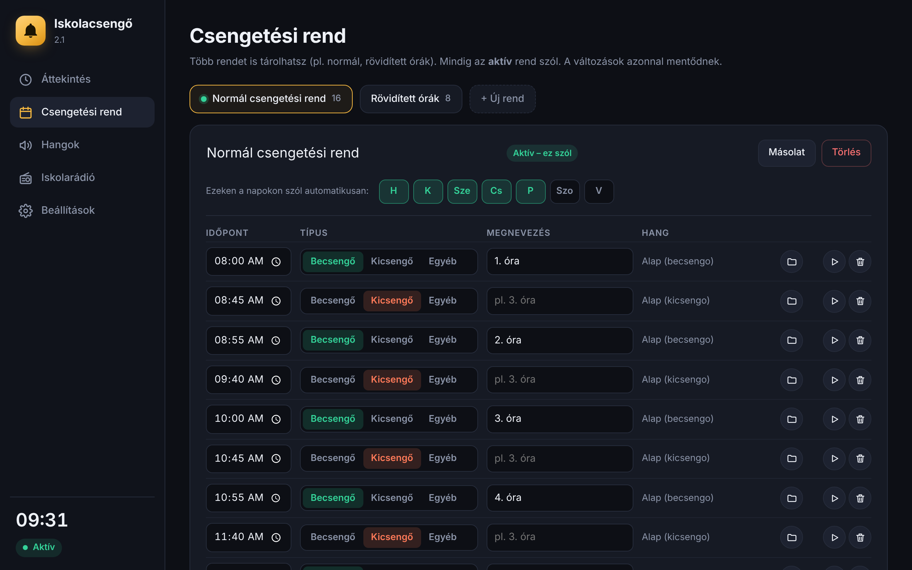
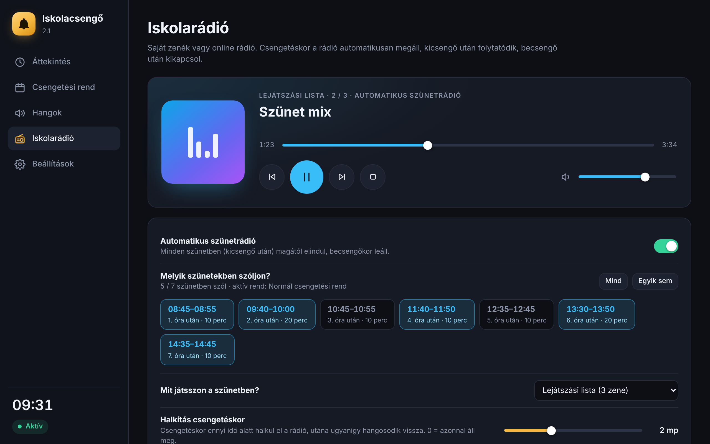

# 🔔 Iskolacsengő

Ingyenes, magyar nyelvű iskolai csengetőprogram Windowsra, beépített **iskolarádióval**.

**[⬇ Letöltés – 2.1-es verzió (Windows, 47 MB)](https://github.com/tkaleczmilan/iskolacsengo/raw/main/letoltes/IskolaCsengo-win-x64.zip)**
Egy gépen fut a háttérben, és pontosan csenget a beállított csengetési rend szerint.



## Mit tud?

**Csengetés**
- Automatikus be- és kicsengetés a beállított csengetési rend szerint, a kiválasztott napokon.
- **Több csengetési rend** (pl. normál, rövidített órák), egy kattintással váltható.
- „+ Új tanóra” gomb: megadod az óra és a szünet hosszát, az időpontokat a program kiszámolja.
- Kézi becsengetés/kicsengetés, és egy kapcsoló, amivel ki lehet kapcsolni az automatikus csengetést (pl. szünnapon).
- **Bármilyen hangfájl** lehet csengőhang (mp3, wav, m4a, wma, flac). Egy-egy csengetéshez saját hang is beállítható.
- Állítható a csengetés hossza és hangereje, a végén pedig fokozatosan elhalkul.
- **Egyéb jelzések** (pl. Himnusz, tűzriadó): a főoldalról egy kattintással indíthatók.

**Iskolarádió**
- Lejátszási lista a saját zenéidből (fájlok vagy egész mappa), keveréssel.
- Online rádióadások (stream cím alapján), automatikus újracsatlakozással.
- **Automatikus szünetrádió:** kicsengő után magától elindul, becsengőkor leáll. Kiválaszthatod, **melyik szünetekben** szóljon.
- Csengetéskor a rádió fokozatosan elhalkul, utána visszahangosodik.
- **Ütemezett hangok:** adott időpontban, adott napokon lejátszik egy fájlt (pl. reggeli zene 7:45-kor, Himnusz hétfőnként).

**Üzemeltetés**
- Bezáráskor a tálcán fut tovább, onnan jobb gombbal is lehet csengetni.
- Indulhat a Windows-zal együtt.
- Amíg fut, nem engedi alvó módba menni a gépet (a kijelző kikapcsolhat).
- **Napló** minden csengetésről, így utólag ellenőrizhető, mikor szólt.

| Csengetési rend | Iskolarádió |
|---|---|
|  |  |

## Telepítés

1. **[⬇ Letöltés: IskolaCsengo-win-x64.zip](https://github.com/tkaleczmilan/iskolacsengo/raw/main/letoltes/IskolaCsengo-win-x64.zip)** (kb. 47 MB)
2. Csomagold ki egy olyan mappába, ahol maradhat (pl. `C:\IskolaCsengo` vagy az Asztalra).
3. Indítsd el az `IskolaCsengo.exe` fájlt.

Semmit nem kell külön telepíteni, mert a .NET benne van a csomagban. A felülethez a **Microsoft Edge WebView2 Runtime** kell, ez Windows 10 és 11 alatt szinte mindig fent van. Ha mégsem, [innen letölthető](https://developer.microsoft.com/microsoft-edge/webview2/).

> **„A Windows megvédte a számítógépet” figyelmeztetés:** a program nincs digitálisan aláírva (ez évi több száz euróba kerülne), ezért a Windows az első indításkor figyelmeztet. Kattints a **További információ**, majd a **Futtatás mindenképp** gombra.

## Frissítés régebbi verzióról

A beállításaid, saját hangjaid és a csengetési rend **megmaradnak**, csak az új funkciók kerülnek be.

1. **Lépj ki a programból:** tálca ikon (csengő az óra mellett), jobb gomb, **Kilépés**.
2. Töltsd le az új zipet, és csomagold ki **ugyanabba a mappába**, ahol eddig volt. Ha a Windows kérdezi, válaszd a **fájlok cseréjét**.
3. Indítsd el újra az `IskolaCsengo.exe` fájlt.

> Ha véletlenül új mappába csomagoltad ki, a program alapbeállításokkal indul. Ilyenkor lépj ki, és másold át a régi helyről az **`adatok`** mappát az új mellé. Ebben van minden beállításod.

### Változások

**2.1**
- Szünetrádió: kiválasztható, melyik szünetekben szóljon (csengetési rendenként külön).
- Frissítési útmutató.

**2.0**
- Új felület, iskolarádió, ütemezett hangok, több csengetési rend, egyéb jelzések.

## Első lépések

1. **Csengetési rend** fül: írd át az időpontokat a saját iskolád rendjére, és jelöld be, mely napokon csengessen.
2. **Hangok** fül: a „Hang cseréje…” gombbal válaszd ki a saját be- és kicsengődet.
3. **Beállítások** fül: kapcsold be az „Indítás a Windows-zal” lehetőséget, hogy újraindítás után is fusson.
4. Zárd be az ablakot. A program a tálcán (az óra mellett, csengő ikon) tovább fut.

> Kilépni a tálca ikon jobb gombos menüjében lehet. Amíg a program nem fut, **nem szól a csengő**.

## Hol vannak a beállítások?

- Ha a program mappája írható (pl. Asztal, `C:\IskolaCsengo`), akkor a program melletti **`adatok`** mappában (hordozható mód).
- Ha nem írható (pl. `Program Files`), akkor a `%LOCALAPPDATA%\IskolaCsengo` mappában.

Itt van a `beallitasok.json`, a `hangok` mappa és a `naplo.txt`. **Biztonsági mentéshez elég ezt a mappát lemásolni.** A Beállítások fülön a „Mappa megnyitása” gomb pontosan megmutatja, hol van.

## Online rádió tipp

A közvetlen stream cím működik biztosan (általában `.mp3` vagy `.aac` végű, vagy `/stream`-re végződik). A `.m3u`, `.pls`, `.m3u8` lejátszási-lista linkekkel nem mindig.

## Fejlesztőknek

C# / .NET 10 (WinForms + WebView2 felület, NAudio hangkezelés).

```
dotnet build
dotnet publish -c Release -r win-x64 --self-contained -p:PublishSingleFile=true -p:IncludeNativeLibrariesForSelfExtract=true -o kiadas
```

- `MainForm.cs`: időzítés, csengetés, rádió és csengő együttműködése, tálca
- `BellPlayer.cs`, `RadioPlayer.cs`: lejátszás (NAudio)
- `Store.cs`, `Models.cs`: beállítások
- `ui/`: a felület (HTML/CSS/JS)

A felület böngészőben is megnyitható (`ui/index.html`): ilyenkor próbaadatokkal, „demó módban” fut.

## Készítők

A program alapját Tkalecz Milán írta. A 2.0-s verzió felületét és új funkcióit (iskolarádió, ütemezett hangok, több csengetési rend stb.) [Claude](https://claude.ai) segítségével készítette.

Az alap csengőhangok és az ikon a projekthez készültek, szabadon használhatók.

## Licenc

[MIT](LICENSE): szabadon használható, módosítható és továbbadható, **garancia nélkül**.
Hibát jelezni és ötletet beküldeni az *Issues* részben lehet.
